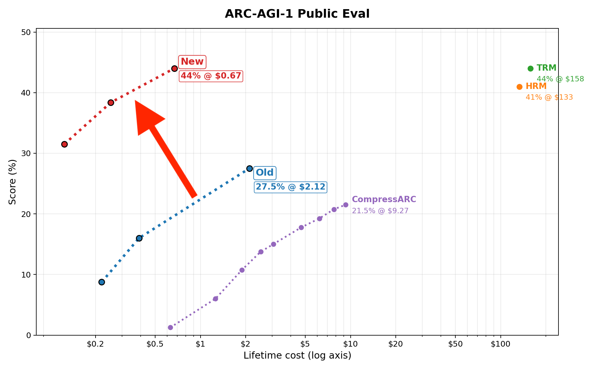

# mdlARC

`mdlARC` is a compact ARC training stack built around a transformer and a local
JSON experiment runner.

`ddp-scaling-ladder` supports single-node multi-GPU training through the existing
launcher. See the [DDP guide](specs/README_ddp.md) and
[two-demo DDP spec](specs/arc2_family_development_two_demo_ddp.json).

- A historical model trained from scratch reached 44% on ARC-AGI-1 public eval
- Runs on a CUDA GPU for practical training and evaluation
- Uses a standard transformer with about 75M parameters

<a href="https://mvakde.github.io/blog/44-on-arc-1/"></a>

On `scaling-ladder`, the default builds on **Context color + schedule + two lookup**,
the reference recipe that scored **215/400 (53.75%)** on ARC1 public evaluation in
`contextcolor-schedule-e330-b64-20261020-233101-r2`. This is a historical result
from `codex/context-color-augmentation`, not a new measurement on this branch.
The branch starts from that implementation (`e698e12`), before the subsequent
shifted-attention and inference-cache experiments. It now adapts the reusable
training and decoding optimizations while preserving this model's two lookups.

[`specs/pretrain_eval.json`](specs/pretrain_eval.json) is the default experiment;
[`specs/example.json`](specs/example.json) uses the same optimized recipe.
Both select **FA4, attention dropout 0, and automatic greedy speculative decoding**.
Embedding and feedforward dropout remain 0.1. The named
[`context-palette template`](specs/context_palette_schedule_two_lookup.json)
retains the historical FA2/attention-dropout-0.1 reference. The optimized recipe
has no measured ARC score or Blackwell throughput yet.
Training selects half or more of the eligible demos,
uses context-aware color augmentation, and predicts one target output:

```text
<start> demo 1 input <input_output_separator> demo 1 output <end_pair>
        ... selected demonstration pairs ...
        target input <input_output_separator> target output <end_pair>
```

Each demo reads its own pair and the target input. Target tokens use separately
normalized target and demo attention lookups, mixed by learned per-head gates.
The output remains causal and is the only supervised part. Task embeddings,
dihedral embeddings, and simplex pair identities are disabled. Evaluation uses
balanced leave-one-out contexts with 80 augmentation attempts. See the
[color policy](specs/README_context_palette.md) and
[demo schedule](specs/README_demo_ablations.md).

The reference recipe retains ARC1 + ConceptARC + filtered data, width 768,
8 layers, 12 heads, FFN 3072, batch 64, 330 epochs, seed 42, FA2, NorMuon
0.004, AdamW 0.00072, and four prediction heads with the saved MTP schedule.
The planned scaling ladder will use ARC2 train + ARC2 eval + compositions from
both splits + ConceptARC + filtered data. Model/data ladder sizes, composition
snapshots, and further B200/B300 tuning remain future work. No scaling run has
been launched.

For a CUDA 13 B200/B300 environment, use `pip install -r requirements-fa4.txt`.
FA4 is pinned to `flash-attn-4[cu13]==4.0.0b36`; the ordinary Colab and Vast
workflows install it only when selected. An FA4-only Colab snapshot skips the
historical A100 FA2 wheel. Remote setup verifies native BF16 rectangular
attention and gradients, and `validate_cuda=true` checks the selected backend's
compiled two-lookup model before training. These CUDA checks have not been run
on the local Mac. Missing FA4 on CUDA raises an error rather than using padding.

Training uses the stable hard-label cross-entropy in `src/stable_losses.py` for
the main output and every MTP head. It preserves tiny losses and target gradients
when a correct token is very confident, with FP32 accumulation for BF16/FP16
logits. Its analytic first-order backward is captured by the existing
`torch.compile` training path; masks, reductions, and checkpoint weights are
unchanged. `soft_target_cross_entropy(student_logits, teacher_logits)` provides
the corresponding cancellation-resistant distillation loss, detaching the
teacher and returning an exactly zero student gradient for equal logits. It is
not called by ordinary hard-label training. Both follow
[Barron et al.](https://jonbarron.info/softmaxfix/); neither changes attention.

The reusable loss benchmark compares warmed, compiled forward/backward with
standard CE. Use the selected training GPU to establish native throughput; local
CPU timing and compilation checks do not establish GPU speed:

```bash
venv/bin/python benchmarks/benchmark_stable_losses.py --device cuda
venv/bin/python benchmarks/benchmark_stable_losses.py --device cuda --with-projection
```

The second command includes four width-768 output projections and their
gradients. Save timing JSON under ignored `results/<branch>/` when needed.

## All-demo group attention

Set `defaults.attention_pattern="pair_group"` for a fresh model, or use
[`specs/group_attention_pretrain_eval.json`](specs/group_attention_pretrain_eval.json).
This mode selects at most six eligible solved demos from the target's task or
variation. The default `training_demo_schedule="half_or_more"` draws counts
uniformly from `min(6, max(2, ceil(M/2)))` through `min(6, M)`, where M is the
number of eligible demos; tasks with fewer than two use what is available.
Seeded cycles balance each target's demo use to within one at every visit
prefix. A complete training pass over all pairs of a puzzle uses each pair
equally often as context, with the same sampled count for all its targets in
that pass. Dropped or partially sampled passes retain their original visit IDs.
The shared selector applies to ordinary pretraining, family development/full
data, variations, and fine-tuning; it caches bounded permutations and draws at
most six indices, without enumerating combinations or scanning earlier visits.
Training excludes the target pair; test prompts use training demos only.
Evaluation with `inference_demo_policy="leave_one_out"` selects
`min(6, max(0, M-1))` of M solved demos. Five demos therefore give four in the
prompt, while eight give six, matching the largest fine-tuning context. Demo
inclusion counts differ by at most one over any prefix of evaluation attempts,
including the usual 80. The explicit `all` policy selects `min(6, M)` demos.
Set `training_demo_schedule="two"` and `inference_demo_policy="two"` to fix
every context to two eligible demos (or all available when fewer than two),
using the same balanced sampler throughout training and evaluation.
All grids share the target's augmentation, and only target-output tokens are
supervised. No simplex labels or summary tokens are added.

Each demo pair reads its own input/output tokens and the target input. Target
queries use two separately normalized attention lookups with the same Q/K/V
projections: one over the target input and causal output history, and one over
all demos. A learned per-head gate mixes these results as (1-gate) * target +
gate * demos. Gate weights and biases start at zero, giving an initial gate of
0.5; shared model weights retain the baseline seed initialization. With no
demos, only the target lookup is used. START belongs to the target hub. No
prefix token can read any target-output token, and future outputs remain masked.
These rules apply during training, prompt prefill, and cached generation.

RoPE retains column/row coordinates and assigns fixed roles: demo input=1,
demo output=2, target input=3, target output=4, start=0. The target keeps roles
3/4 regardless of the number of demos or which pair is held out for training.
Pair membership is derived from the pair boundaries once per forward pass and
controls attention, without learned pair identities.
Reordering complete demos preserves target predictions in deterministic
evaluation, up to numerical differences. Serialized grid counters remain in
the data/streaming position state and are mapped to roles before RoPE. Training
identifies the target at its separator, prompt prefill at the final separator,
and cached decoding assigns every generated token role 4, including speculative
verification blocks. Spatial coordinates keep the existing boundary convention.

Packed CUDA training uses CPU-prepared ragged metadata from the final augmented
batch, transferred asynchronously with pinned memory. Demo spokes and target
input queries share one noncausal FlashAttention call, with independent segments
and softmaxes. Causal outputs and the combined demo lookup use two further calls.
The target/demo gate is projected only for rows that consume it. Layouts are
shared across layers and no GPU-side layout builder runs on prepared batches.
Prompt prefill builds the same ragged metadata once.
The padded/CPU reference uses explicit masks for the same two normalizations.
Cached generation carries demo membership alongside the ordinary K/V buffers,
including speculative verification blocks. Fresh pair-group models enable
`split_target_demo_attention`; checkpoints preserve this architecture field.

Production decoding prepares immutable K/V for one combined demo segment per row
and a smaller mutable target cache. Finished greedy rows are compacted; sampling
preserves its original row/RNG schedule. `inference_speculative="auto"` uses the
MTP heads only for greedy decoding, verifies proposals with the main head, and
falls back to ordinary generation for one-head checkpoints. Explicit `false`
selects ordinary decoding. Both routes skip unused Flex masks and use bounded
compiler fallback for varying decode shapes. The full-cache route remains
available for parity diagnostics.

Capacity is derived from the selected tasks' pair counts, including variation
pools, allowing 30x30 grids and a target. It is a length limit, not padding;
new evaluation tasks can extend it because role RoPE has no sequence-length
parameters. Separator indices are 32-bit for contexts beyond 32,767 tokens.
Actual GPU capacity and speed depend on the task lengths and require a capacity
probe; the example spec's batch sizes are inherited recipe values.

Group checkpoints save `all_demo_pair_group_target_roles_two_lookup_v1` and the attention
mode. The earlier `all_demo_pair_group_v1` shared-role checkpoints require their
original source; this corrected format requires fresh training and rejects
those checkpoints rather than silently changing their positional behavior.
Resume/finetuning must preserve the mode, and evaluation inherits it. Existing
two-demo checkpoints/specs retain `attention_pattern="dense"`; changing their
mode requires fresh training. This implementation does not launch a run.

## Workflow

The current repo workflow is:

1. Download and group ARC assets into `assets_tmp/`
2. Build training/eval JSON files into `assets/`
3. Run pretraining
4. Optionally run finetuning
5. Evaluate checkpoints and write submissions or accuracy reports under `results/<branch>/runs/`

The main entrypoint uses the default reference recipe when `--config` is omitted:

```bash
python launch_run.py --preview
# Select another recipe explicitly:
python launch_run.py --config path/to/spec.json --preview
```

Fresh model defaults follow R1 1k/1k: eight layers, width 768, twelve heads,
FFN width 3072, learned input shortcuts, four prediction heads and MTP weight
0.3 throughout training. RoPE uses column/row/role coordinates
with both frequency bases at 1000. The spatial base remains configurable; the role
base is fixed. Xavier initialization, original boundary positions and the
existing pre-RMSNorm blocks are fixed, with no extra role embeddings or
query/key or internal branch normalization. The default task latent bank is
`min(3072, task count)`; explicit sizes and saved checkpoint sizes are preserved.
Epochs, augmentation, batch sizes and learning rates remain configurable.
The default recipe sets `defaults.task_embeddings=false`, disabling both
input and task-dependent value embeddings, including their shortcuts. The
disabled parameters stay frozen in checkpoints to preserve identical shared
initial weights across the ablation. Transform-ID embeddings default off.
The [pretraining spec](specs/pretrain_eval.json) keeps batch 64, 330 epochs,
context-aware color augmentation, and the historical learning rates:
NorMuon 0.004 and AdamW 0.00072. Explicit alternative specs and checkpoint
inheritance retain their existing behavior.

Preview a resolved run without executing it:

```bash
python launch_run.py --config path/to/spec.json --preview
```

Each pretraining, finetuning, and evaluation stage runs sequentially in its own
process so CUDA memory and compiler state are released between stages. A failed
stage stops the run before subsequent stages start.

**Never stop or destroy the rented Vast B300, instance 57431449, at any cost.**
Keep it powered on through retries, failures, successful completion, budget
limits, deadlines, and backup recovery. End training when required while
retaining the running VM. This user rule overrides automatic cleanup settings;
see [AGENTS.md](AGENTS.md) and the [Vast workflow](workflows/vast/README.md).

For remote experiments, use [Vast](workflows/vast/README.md) or
[Colab with cached Drive authentication](scripts/colab_oauth/README.md).
Double-click `workflows/vast/Run.command` to choose; Vast is preselected and
the Colab option uses the saved experiment-account credential. Once configured,
both workflows reuse their own Drive refresh token across new VMs. Renew expired
or revoked grants through their setup commands. Manual Colab sign-in remains
an explicit legacy fallback.

On Colab, create a fresh VM and launch with `scripts/colab_oauth/launch.py`.
It authorizes the VM and delegates to `scripts/run_on_colab.py`, preserving
reconnect to the same job, saved-log monitoring, verified backup/result recovery,
Mac idle-sleep protection, and guarded shutdown. After a terminal closes, use
`scripts/run_on_colab.py --watch-session <session>` to reattach. On Vast, use
`workflows/vast/run.py launch`; after confirmed handoff the remote supervisor
owns training, backups, and cleanup. Use `watch` or `sync` for later recovery.
See the [Colab guide](scripts/README_colab.md) and
[Drive setup](scripts/README_colab_drive.md) for details.

SF Compute Autoresearch is also available in the same native chooser, or with
`workflows/vast/choose.py --backend sfcompute -- --config <spec>`. It uses the
installed `autor` CLI and the provider's command/file API, with the shared
detached supervisor and verified Drive backups. CLI credentials and its saved
infrastructure policy stay outside Git. See the
[SF Compute guide](workflows/sfcompute/README.md) for setup, image requirements,
offline preview and recovery.

When training logs are enabled, every epoch reports `color_accuracy`,
`special_token_accuracy`, and `exact_output_accuracy` alongside loss. These are
teacher-forced training metrics over supervised output tokens, excluding prompt
and padding tokens. Exact output accuracy requires every supervised output token,
including row separators and the end token, to be correct; episodes with no
supervised output are excluded. The `accuracy-only` evaluation mode uses the same
metric calculation on evaluation targets.

## Branch results

Run artifacts live in ignored `results/<git-branch>/`, with `colab_runs/` for
Colab recovery files, `vast_runs/` for Vast records and recovered artifacts,
`runpod_runs/` and `sfcompute_runs/` for their respective provider records,
`experiments/` for Colab journals/research notes/trial records,
and `runs/` for local execution outputs. These directories persist across branch
switches and are excluded from commits. Reusable specs and trial templates stay
in `specs/`. Branch names containing `/` use percent-encoded directory names.
Local `runs/...` checkpoint references resolve inside the selected branch's runs directory.

Every change and run includes an explicit file-tracking decision: reusable
code, tests, docs and templates belong in Git; generated outputs, caches and
one-off configs belong in ignored paths. Agents must handle these choices and
report them without leaving new files for the user to classify. See
[the file-tracking policy](AGENTS.md#file-tracking-and-generated-artifacts).

On `newreason`, use `results/newreason/`; on the historical whole-task branch
`colab-restart`, use `results/colab-restart/`. Their canonical
Drive records are under `mdlARC/runs/newreason` and `mdlARC/runs/colab-restart`.
Every future branch gets its own namespace. The launcher freezes that identity
and backs up local journals and notes as well as VM results. After a VM stops,
ask Codex to sync later note edits through connected Drive; unsynced edits are
local pending changes. See the [storage and sync workflow](scripts/README_colab_drive.md#branch-records-and-local-cache).


## Repository Layout

- `launch_run.py`: local experiment runner
- `src/train.py`: training loop and optimizer setup
- `src/evaluate.py`: inference, AAIVR voting, and submission generation
- `src/build.py`: model/data construction and checkpoint loading
- `dataset_building_scripts/`: dataset download and asset generation
- `tests/`: lightweight unit tests

## Requirements

- Python 3.10+
- CUDA GPU for practical training and evaluation
- PyTorch with CUDA support
- `flash-attn`
- Packages in `requirements.txt`

The October 2026 eMudhra incident requires pip 26.2.2 or newer and
certifi 2026.10.19 or newer. If using uv, update it to 0.13.4 or newer first
(on Homebrew: `brew update`, then `brew upgrade uv`). Update each existing
virtual environment as well as newly created ones. pip bundles its own CA
certificates, so updating certifi alone does not update pip's trust store.

Bootstrap pip using the hash-verified wheel recommended by the
[Python security guidance](https://discuss.python.org/t/information-for-python-users-regarding-emudhra-emsign-ca-certificate-security-incident/109576),
then update certifi before downloading other dependencies:

```sh
python -m pip install "pip @ https://files.pythonhosted.org/packages/3f/06/3e4420302363fbb71be3c7f35ce042f54bfca330e3e66b3a2e3c4cca579f/pip-26.2.2-py3-none-any.whl#sha256=fd7f4dfa8190e014013b9f08f3e973f4e4c26ffd179a204895533a7254813a70"
python -m pip install 'certifi>=2026.10.19'
```

Use the Python executable of the environment being updated. An environment
without pip can instead use the updated uv to install certifi with
`uv pip install --python python 'certifi>=2026.10.19'`.

Install dependencies in your environment:

```bash
pip install -r requirements.txt
```

`flash-attn` and PyTorch need to match your local CUDA setup. Experiment configs
default to `device="cuda"`.

## Run Specs

Run specs are plain JSON files passed through `--config`. A minimal pretrain spec:

```json
{
  "run_name": "arc2-pretrain",
  "dataset": {
    "style": "pretrain",
    "dataset": "arc2",
    "add_rearc": null
  },
  "enable_finetune": false,
  "pretrain": {
    "epochs": 30,
    "checkpoint_epochs": []
  },
  "evals": {
    "final": {
      "checkpoint": "pretrain.final"
    }
  }
}
```

A pretrain plus finetune spec:

```json
{
  "run_name": "arc2-finetune",
  "dataset": {
    "style": "finetune",
    "dataset": "arc2"
  },
  "pretrain": {
    "epochs": 30,
    "checkpoint_epochs": []
  },
  "finetunes": {
    "default": {
      "epochs": 30
    }
  },
  "evals": {
    "final": {
      "checkpoint": "finetune.default.final"
    }
  }
}
```

An eval-only spec for an existing checkpoint:

```json
{
  "run_name": "arc1-eval-10",
  "eval_only": true,
  "checkpoint": "runs/arc1-pretrain/pretrain/tiny.pt",
  "skip_data_build": true,
  "dataset": {
    "style": "pretrain",
    "dataset": "arc1",
    "add_rearc": null
  },
  "eval_defaults": {
    "max_augments": 10
  },
  "evals": {
    "final": {
      "checkpoint": "checkpoint"
    }
  }
}
```

Choose the evaluation method in `eval_defaults` or override it in an individual
`evals.<name>` stage:

```json
"eval_defaults": {
  "mode": "accuracy-only",
  "batch_size": 120,
  "enable_aug": true,
  "max_augments": 80
}
```

- `full-decode` (default) generates outputs and runs the existing AAIVR voting,
  submission, scoring, and visualization pipeline.
- `accuracy-only` runs each inference prompt plus its transformed correct output
  through the model in one forward pass per packed batch. Only target output
  predictions count, including row separators and the final end token. The
  prompt keeps its bidirectional attention and the output remains causal.

Accuracy-only writes `accuracy.json`. Its `splits.test.summary` contains
`exact_output_accuracy`, `color_accuracy`, and `special_token_accuracy` as
fractions from 0 to 1, plus their correct/total counts. Exact output accuracy is
the fraction of **attempts** with every target token correct, averaged across the
same augmented prompts used by full decoding. It is not an AAIVR or ARC score.
For a fixed prompt, this tests whether greedy decoding would produce the entire
reference token sequence (apart from possible numerical differences between
attention kernels); sampling temperature and top-k settings are ignored.

Correct outputs come from `assets/solutions.json` or inline evaluation outputs.
Missing or conflicting targets and sequences exceeding model capacity fail
explicitly. Accuracy-only always writes its metrics and skips ARC scoring and
visualization, regardless of `score_results` and `visualize`. Keep the evaluation
data, augmentation count, and seed fixed when comparing model changes. For one
unaugmented attempt per test pair, set `enable_aug: false`.

Key points:

- `dataset.style` is `pretrain` or `finetune`
- `dataset.dataset` is `arc1`, `arc2`, or `conceptarc`
- `conceptarc` is a pretrain-only benchmark mode; it requires `keep_train_test_separate: true`, disables dataset add-ons, and evaluates the held-out test pairs by default
- `dataset.add_rearc` is an integer sample count or `null`
- `dataset.add_nvarc_training` and `dataset.add_nvarc_full` optionally stage NVARC folders into `assets/`
- `enable_finetune` defaults on when `dataset.style` is `finetune`
- `checkpoint` at the top level resumes pretraining, or supplies the source model for an eval-only run
- `eval_only: true` skips all training stages and requires a top-level `checkpoint`
- eval-only stages use `"checkpoint": "checkpoint"` to reference that file
- `checkpoint_epochs` may be an integer cadence, a list of epochs, `[]`, or `null`
- `checkpoint_keep_last` accepts a positive integer in any training spec's `defaults`,
  `pretrain`, `finetune_defaults`, or individual `finetunes` settings. Omit it or use
  `null` to keep all checkpoints. `1` deletes the previous local/VM checkpoint only
  after its replacement is safely saved; the final checkpoint takes the last slot.
  Drive-backed runs prune in the background after verified uploads, preserving
  canonical Drive backups and keeping network transfers off the training path.
- every stage also keeps `tiny.epochNNN.pt` every `kept_checkpoint_every` epochs (default 50,
  backed up) and overwrites a local-only `tiny.rolling.pt` every `rolling_checkpoint_every`
  epochs (default 10; not backed up, removed after the final save); 0 disables either
- eval stages reference `pretrain.final`, `pretrain.epoch.<N>`, `finetune.<name>.final`, or `finetune.<name>.epoch.<N>`
- `skip_evals: true` disables evaluation for train-only runs
- `FA` may be set globally or per stage and must be `2`, `3`, or `4`; FA4 training requires `attention_dropout: 0`

### ARC-2 task-variation runs

Three ARC-2 full-run specs use the approved `task-variations-v1` snapshot:

- `specs/arc2_variations_finetune.json` trains on rotated variations, then
  finetunes on the original ARC-2 eval demonstration pairs.
- `specs/arc2_variations_joint.json` mixes those demonstrations into variation
  pretraining from the start.
- `specs/arc2_variations_originals_big_batch_finetune.json` mixes originals with
  all 42 variations every epoch, using batch 96 and 90 pretraining epochs.

These specs train on variations of ARC-2 train, ConceptARC, and ARC-1 filtered source
tasks. ARC-2 eval variations and ARC-2 eval test outputs never enter training.
The new optional `dataset.pretrain_data` block selects this mode. Without that
block, all existing dataset fields and presets retain their previous behavior.
Variation mode does not combine with the legacy `add_*` dataset flags or
`prefinesub`; `original_sources` explicitly adds
original ARC-2 train, ConceptARC, or ARC-1 filtered tasks if desired.

`dataset.evaluation.source` independently selects the original evaluation data.
Existing specs default to `arc2_eval`; `arc1_eval` also uses its official split.
Parent-task sources (`conceptarc`, `arc2_train`, or `arc1_filtered`) require a
fixed, repository-relative `dataset.evaluation.split_manifest`. Its explicit
training IDs filter both variations and `original_sources` for that source.
Evaluation groups always use the original tasks, with test answers stored only
in solution files. Split runs keep all held-out demonstration pairs out of
pretraining, including when finetuning is disabled.

### ConceptARC variations with a fixed split

`specs/conceptarc_variations_finetune.json` uses
`dataset_building_scripts/dataset_splits/conceptarc_topbottom3d_v1.json`:

- 120 training parents: eight from each of the 15 remaining concepts.
- `familiar`: 30 original held-out tasks, two per remaining concept.
- `heldout_concept`: all 10 original TopBottom3D tasks.

Count stays among the 15 familiar concepts. MoveToBoundary9 and
MoveToBoundary10 stay together because they share demonstration pairs.
The checked-in task lists define the split; changing the model or run seed
does not select new test tasks. There are 5,040 training variation files.
Neither evaluation group uses generated task variations.

Pretraining runs for 42 epochs, covering one full variation cycle. Finetuning
uses only the original demonstration pairs from all 40 held-out tasks together.
The two evaluation stages read separate challenge/solution files and score
90 familiar-concept test inputs and 30 TopBottom3D test inputs independently,
from the same final finetune checkpoint. Inference augmentation remains an
evaluation setting, as in the ARC-2 specs; it does not generate new tasks.

```bash
python launch_run.py --config specs/conceptarc_variations_finetune.json --preview
python launch_run.py --config specs/conceptarc_variations_finetune.json
```

The spec sets `dataset.evaluation.source="conceptarc"` and names the manifest.
Each `evals` entry chooses `group="familiar"` or `group="heldout_concept"`.
`group="all"` explicitly evaluates their union; omitted evaluation stages
default to separate stages for each manifest group. The finetune stage always
uses the union. A pretrain-only experiment can set `enable_finetune=false`
and evaluate the same groups from `pretrain.final`.

The builder checks the original source-content hash, full/disjoint task
coverage, and exact solved-pair overlap across the split. It copies the
manifest into the run data and records its identity in the variation index
and checkpoints. Resuming with a different split is rejected; cached run data
is also checked against the requested manifest when `skip_data_build=true`.
Colab source
snapshots include the manifest alongside the code and selected spec.

`shuffled_cycle` chooses one of each source task's 42 variations per epoch in a
fixed per-task order. With one variation per task per epoch, 42 epochs cover all
seeds once. Every solved pair in the selected variation is eligible as a target;
each sequence contains only that target's input and output. By default, all
variations of a source task use the same task embedding. The big-batch mixed
spec instead uses `embedding_scope="variation"`: each original and variant has
its own trainable row, with all rows in a family initialized identically on a
fresh model. Resume preserves their learned differences. It also sets
`deduplicate_variation_inputs=false`; originals keep their unique-input
augmentation checks, while variations retain color protection without those
checks. Generated run-local data and the archive hash
are stored under `results/<branch>/runs/<run_name>/data/` and in training checkpoints.

Local runs require the approved ZIP at `assets_tmp/task-variations-v1.zip`.
The builder verifies its size and SHA-256 and extracts it if needed. The Colab
launcher detects variation specs and downloads the ZIP from restricted Drive
automatically. Preview a resolved run without training with
`python launch_run.py --config specs/arc2_variations_finetune.json --preview`.

Generated artifacts are written under:

```text
results/<branch>/runs/<run_name>/
```

Typical outputs include:

- `results/<branch>/runs/<run_name>/pretrain/tiny.pt`
- `results/<branch>/runs/<run_name>/finetunes/<name>/tiny.pt`
- `results/<branch>/runs/<run_name>/evals/<name>/submission.json`
- `results/<branch>/runs/<run_name>/evals/<name>/score.json` when scoring is enabled
- `results/<branch>/runs/<run_name>/evals/<name>/accuracy.json` for accuracy-only evaluation
- `results/<branch>/runs/<run_name>/timing.txt`
- `results/<branch>/runs/<run_name>/**/training_log.txt`

## Dataset Build Pipeline

Dataset preparation lives in `dataset_building_scripts/`.

`download_and_group.py` downloads and normalizes:

- ARC-AGI-1
- ARC-AGI-2
- ConceptARC
- RE-ARC

Downloads are pinned to fixed upstream commits in
`dataset_building_scripts/download_and_group.py`, rather than moving branches.
The pinned ARC-1, ARC-2, and ConceptARC task data matches the existing grouped
assets checked on 2026-09-26. Existing grouped assets are still reused; pinning
only changes future downloads.

Keep your own copies of these archives if you need protection against upstream
repositories being deleted. A commit pin fixes the version but does not provide
a backup:

- [ARC-1 ZIP](https://github.com/fchollet/ARC-AGI/archive/399030444e0ab0cc8b4e199870fb20b863846f34.zip)
- [ARC-2 ZIP](https://github.com/arcprize/ARC-AGI-2/archive/f3283f727488ad98fe575ea6a5ac981e4a188e49.zip)
- [ConceptARC ZIP](https://github.com/victorvikram/ConceptARC/archive/0e67da6af879e4bad3d7cd3c196e8d551b445725.zip)
- [RE-ARC task ZIP](https://raw.githubusercontent.com/michaelhodel/re-arc/e5b7f1d06362a76f9d3b8c25154ff1fafca897ce/re_arc.zip)

For a quick ConceptARC-only build, use:

```bash
python dataset_building_scripts/download_and_group.py --conceptarc-only
python dataset_building_scripts/build_datasets.py --style pretrain --dataset conceptarc --keep-train-test-separate
```

Or run it through `launch_run.py` with a minimal dataset config:

```json
{
  "run_name": "conceptarc-smoke-test",
  "skip_evals": true,
  "dataset": {
    "dataset": "conceptarc",
    "keep_train_test_separate": true
  },
  "pretrain": {"epochs": 2, "checkpoint_epochs": []}
}
```

A ready-to-run copy is available at `specs/conceptarc_smoke.json`:

```bash
python launch_run.py --config specs/conceptarc_smoke.json
```

The smoke spec only validates the ConceptARC build and training path. For the
full 90-epoch pretrain-plus-evaluation run, use:

```bash
python launch_run.py --config specs/conceptarc_pretrain_eval.json
```

ConceptARC-only builds write test inputs to `assets/challenges.json` and the
corresponding held-out answers to `assets/solutions.json`. Training consumes
only each task's `train` pairs; evaluation and scoring use its `test` pairs.

`build_datasets.py` then produces repo-local assets such as:

- `assets/challenges.json`
- `assets/solutions.json`
- `assets/priv_challenges.json`
- `assets/rearc_challenges.json`
- `assets/nvarc_training/` when `--add-nvarc-training` is requested
- `assets/nvarc_full/` when `--add-nvarc-full` is requested

You usually do not need to call these scripts directly because `launch_run.py`
does it for you. If grouped assets already exist, the download step is skipped.
If `./.dataset-build-venv` exists, dataset build scripts use it automatically.
If `./.dataset-build.env` exists, it is loaded for dataset-script subprocesses.

NVARC notes:

- The current builder downloads [NVARC Synthetic Puzzles](https://www.kaggle.com/datasets/sorokin/nvarc-synthetic-puzzles),
  whose archive contains the training/full folders it stages. Download using
  the Kaggle page's Download button or
  `kaggle datasets download -d sorokin/nvarc-synthetic-puzzles`.
- Related source datasets: [NVARC Artifacts Puzzles](https://www.kaggle.com/datasets/sorokin/nvarc-artifacts-puzzles)
  and [NVARC Augmented Puzzles](https://www.kaggle.com/datasets/sorokin/nvarc-augmented-puzzles).
  These are separate datasets, not additional downloads required by this builder.
  See the [authors' download instructions](https://github.com/1ytic/NVARC#synthetic-data-generation).
  Keep ZIP copies in your private storage if upstream availability matters;
  these Kaggle downloads are not revision-pinned by the ARC pin change.
- NVARC is train-only and is never loaded for evaluation/inference.
- The builder keeps NVARC as raw folders instead of merging it into `challenges.json`.
- Enabling NVARC requires the `kaggle` CLI plus `KAGGLE_API_TOKEN` or `KAGGLE_USERNAME`/`KAGGLE_KEY` credentials.

## Notes

- The runner scores eval outputs against `assets/solutions.json` by default when solutions are available.
- Visualization is supported by the runner but is off by default.
- The repo assumes local writable `assets/` and `results/<branch>/runs/` directories.

## Citation

```bibtex
@misc{vakde2025mdlarc,
  author       = {Mithil Vakde},
  title        = {mdlARC},
  year         = {2025},
  url          = {https://github.com/mvakde/mdlARC},
}
```
