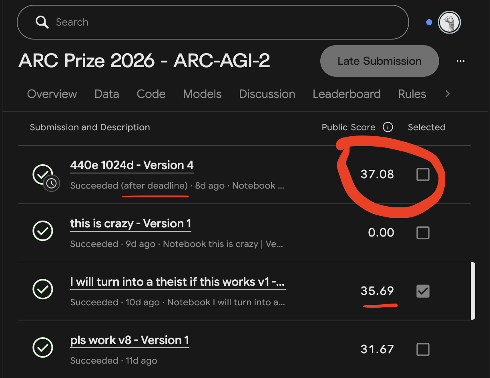

# Kaggle submissions (ARC Prize 2026, ARC-AGI-2)

The two notebooks below are the exact files submitted to the ARC Prize 2026 Kaggle competition
(byte-identical to the submitted versions). Each one fine-tunes a pretrained looped mdlARC model on
the hidden tasks' demonstrations, then decodes every test input with augmentation voting, inside
Kaggle's limit of 12 hours on 4 × NVIDIA L4 with Internet off.

| Notebook | Submission | Pretrained model | Test-time recipe | Kaggle public score |
| --- | --- | --- | --- | --- |
| [`submit_d1024_e440_ddp4_ft180.ipynb`](notebooks/submit_d1024_e440_ddp4_ft180.ipynb) | 57908007 (final) | d1024 × 6 loop, 440 epochs (99.8M parameters) | one 4-GPU DDP fine-tune, 180 epochs | **37.08**¹ |
| [`submit_d768_e180_ft90.ipynb`](notebooks/submit_d768_e180_ft90.ipynb) | 57850224 | d768 × 6 loop, 180 epochs (76M parameters) | four independent single-GPU fine-tunes, 90 epochs | 35.69 (official leaderboard, rank 141) |

¹ Submitted before the deadline but scored after the leaderboard froze, so the official board shows
the previous looped model at 35.69% (rank 141).



Submission 57908007 (37.08) was made on 2 November 2026 at 12:14 UTC, about 12 hours before the
23:59 UTC deadline. Kaggle marks it "after deadline" because its hidden-set run finished after the
deadline. Submission 57850224 (35.69) was made on 31 October at 20:43 UTC.

## What each notebook needs

Attach three inputs and set **Accelerator: GPU L4 × 4, Internet: off**:

1. The competition data (`arc-prize-2026-arc-agi-2`).
2. The pretrained checkpoint (`tiny.pt`). The d1024 epoch-440 checkpoint is published on Kaggle as
   [`mithilavakde/mdlarc-loopv3-private/pyTorch/d1024-e440`](https://www.kaggle.com/models/mithilavakde/mdlarc-loopv3-private/pyTorch/d1024-e440)
   and on this repository's Releases page as `mdlarc-d1024-e440.pt` (the same file).
   The notebook checks its configuration (width, loop settings, MTP heads) after loading and logs its
   SHA-256.
3. A FlashAttention 2 wheel for Kaggle's Python 3.13 / PyTorch 2.11 / CUDA 12.8 image. The submitted
   notebooks read it from the Kaggle dataset `flash-attn-cp313-torch211-cu128`;
   [`build/flash_attn/`](build/flash_attn/) builds and validates the same wheel.

Everything else is inside the notebook: the training and decoding code is embedded as a zip
(runtime SHA-256 `c364b2ad…32bd2`, the same in both notebooks). To read that code:

```bash
python kaggle_submissions/extract_runtime.py kaggle_submissions/notebooks/submit_d1024_e440_ddp4_ft180.ipynb out/runtime
```

## Recipe of the 37.08 notebook

Settings are in the notebook's second cell; the code there is what ran. (The notebook's first,
descriptive cell was not updated from an earlier per-GPU version and names an older checkpoint.)

- **Fine-tune**: one model, data-parallel over all four L4s (`GPU_TEAMS = ((0, 1, 2, 3),)`), on the
  demonstrations of every hidden task; 180 epochs, batch 1 × 40 accumulation per GPU (effective 160),
  NorMuon lr 0.0008 and AdamW lr 0.00014, 80 training augmentations (context palette), at most 3
  context demonstrations per training sequence (2 after a CUDA out-of-memory error). An ETA guard
  shortens the epochs if the fine-tune would end after hour 10.
- **Decode**: each GPU takes a quarter of the tasks and decodes every test input leave-one-out with
  40 augmentations (8 if the time left is too short); candidate grids are de-augmented and voted, and
  the two most-voted grids are the two attempts.
- **Safety**: an identity `submission.json` is written first and replaced only by validated
  predictions; every stage is wrapped so a failure leaves a valid file; unfinished decode shards are
  stopped at hour 11.3.

The 35.69 notebook differs: four independent single-GPU fine-tunes (seeds 42, 1, 2, 3), 90 epochs at
effective batch 40, each GPU fine-tuning and decoding half of the tasks with 80 augmentations, votes
pooled over the two GPUs of each half, demonstration cap 4 (3 after an out-of-memory error).

One more data point for anyone reusing this: a third notebook with the same 4-GPU DDP fine-tune
scored 0 because it failed during fine-tuning on the hidden rerun, while its own save run had passed.
Independent single-GPU fine-tunes avoid the inter-GPU communication that likely failed there.

## Retraining the pretrained models

The d1024 checkpoint is reproducible from this repository:
[`specs/paper/kaggle_d1024/`](../specs/paper/kaggle_d1024/) holds the pretraining spec (270 epochs)
and the continuation to 440 epochs, both 8-GPU DDP; the training data is described in
[`data_generation/`](../data_generation/).
